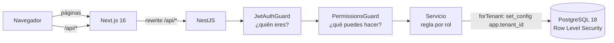
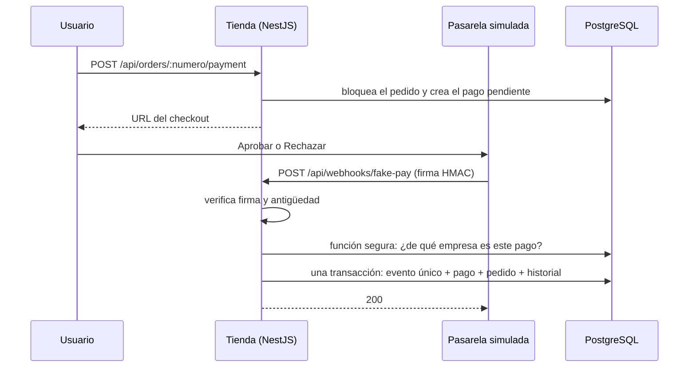

# OrderHub B2B

Portal de pedidos **multi-tenant** para empresas B2B: cada empresa ve solo sus datos y, dentro de ella, cada rol ve y hace solo lo que le corresponde.

Proyecto de portafolio construido con **Next.js 16, NestJS, PostgreSQL 18 y Prisma 7**, enfocado en lo que importa en producción: aislamiento de datos con Row Level Security, permisos por rol, concurrencia correcta, rendimiento medido e integraciones de pago confiables.

---

## Lo que demuestra este proyecto

- **Multi-tenant con dos capas de seguridad:** filtro por empresa en el código **y** Row Level Security en PostgreSQL. Si el código olvida el filtro, la base igual bloquea.
- **Permisos por rol (RBAC)** con una sola matriz compartida entre backend y frontend, y rutas que **fallan cerradas** si no declaran permisos.
- **Concurrencia correcta:** el stock nunca queda negativo, el número de pedido no se repite ni salta, y no hay deadlocks. Probado con 20 pedidos simultáneos contra Postgres real.
- **Rendimiento medido:** paginación por cursor y un listado que pasó de **35,8 ms a 0,36 ms** después de medir con `EXPLAIN ANALYZE` ([ver el análisis](docs/rendimiento-listado-pedidos.md)).
- **Pagos con webhooks firmados e idempotentes:** pasarela desacoplada con el patrón adapter, firma HMAC con protección contra repetición y procesamiento exactamente una vez, aunque el mismo evento llegue dos veces.
- **Sesiones seguras:** JWT en cookies `httpOnly`, refresh tokens rotativos con detección de reuso y renovación automática en el navegador.

---

## Stack

| Capa              | Tecnología                                                                      |
| ----------------- | ------------------------------------------------------------------------------- |
| Frontend          | Next.js 16 (App Router, Turbopack, `cacheComponents`), React 19, Tailwind CSS 4 |
| Datos en el front | TanStack Query 5, TanStack Table 9                                              |
| Backend           | NestJS 12 (ESM), Zod 4                                                          |
| Base de datos     | PostgreSQL 18 + Prisma 7 (`@prisma/adapter-pg`)                                 |
| Caché / colas     | Redis 8 (BullMQ en la fase 2)                                                   |
| Autenticación     | JWT + refresh tokens rotativos, Argon2id                                        |
| Tests             | Vitest (unitarios y de integración contra Postgres real)                        |
| Infra             | Docker Compose, monorepo con pnpm workspaces                                    |

---

## Arquitectura



- **Un solo dominio:** Next reenvía `/api/*` al backend, así las cookies de sesión funcionan sin CORS.
- **Monorepo con pnpm:** `frontend`, `backend` y `shared`. El paquete `shared` contiene los esquemas Zod, los tipos y la matriz de permisos que usan ambos lados.

```
orderhub-b2b/
├── frontend/   Next.js 16
├── backend/    NestJS + Prisma (migraciones, seed y tests de integración)
├── shared/     @orderhub/shared: esquemas Zod, tipos, permisos y reglas de estados
└── docs/       Análisis de rendimiento
```

---

## Seguridad multi-tenant

| Capa                  | Cómo funciona                                                                                                                                                                                                        |
| --------------------- | -------------------------------------------------------------------------------------------------------------------------------------------------------------------------------------------------------------------- |
| **Aplicación**        | El `tenantId` sale **siempre del JWT**, nunca del request. Todas las consultas filtran por él.                                                                                                                       |
| **Base de datos**     | RLS (`ENABLE` + `FORCE`) en todas las tablas con `tenant_id`. Cada transacción define la empresa con `set_config('app.tenant_id', $1, true)`. Sin empresa definida, la base devuelve **cero filas** (falla cerrada). |
| **Roles de Postgres** | La app se conecta con `orderhub_app`: sin superusuario, sin `BYPASSRLS` y solo con `SELECT/INSERT/UPDATE/DELETE` por tabla. Las migraciones usan otro rol. El backend ni siquiera conoce la URL de admin.            |
| **Login**             | Antes de conocer la empresa, el login usa funciones `SECURITY DEFINER` acotadas, que solo buscan por correo o id exacto y no permiten listar usuarios.                                                               |
| **Webhooks**          | Llegan sin sesión. Una función `SECURITY DEFINER` responde solo de qué empresa y pedido es un pago; el resto del proceso corre con RLS activo, como cualquier request.                                               |
| **Historial**         | `order_status_history` es **inmutable**: la app solo tiene `SELECT` e `INSERT`. Los cambios hechos por el sistema (un pago aprobado) quedan sin usuario, no con un usuario ficticio.                                 |

Un test de integración falla si alguna tabla con `tenant_id` queda sin RLS activado y forzado.

---

## Roles y permisos

| Permiso                                        | Admin |    Vendedor    |           Bodega           |
| ---------------------------------------------- | :---: | :------------: | :------------------------: |
| Ver pedidos                                    | Todos | Solo los suyos | Desde "pagado" en adelante |
| Crear pedidos                                  |  Sí   |       Sí       |                            |
| Pagar pedidos pendientes                       |  Sí   | Solo los suyos |                            |
| Avanzar estado (preparar, despachar, entregar) |  Sí   |                |             Sí             |
| Cancelar pedidos pendientes                    |  Sí   | Solo los suyos |                            |
| Ver productos                                  |  Sí   |       Sí       |                            |

- La matriz vive en `shared/src/permissions.ts`: si se agrega un rol sin su fila, **TypeScript no compila**.
- Un pedido que no te corresponde ver responde **404, no 403**, para no confirmar que existe.

---

## Pedidos: decisiones clave

- **Paginación por cursor** sobre el número de pedido (`WHERE number < cursor`): cuesta lo mismo en la página 1 que en la 400.
- **Número correlativo por empresa** (`#1, #2...`), con un contador que se incrementa de forma atómica dentro de la transacción. No hay huecos ni duplicados.
- **Stock atómico:** `UPDATE ... SET stock = stock - n WHERE stock >= n`. Verificar y descontar es **una sola sentencia**, sin condición de carrera.
- **Sin deadlocks:** los productos se bloquean siempre en el mismo orden (por id).
- **Precios desde la base**, nunca desde el navegador. El precio queda guardado en el pedido como foto del momento.
- **Bloqueo optimista** al cambiar estado: `UPDATE ... WHERE status = <el que viste>`. Si alguien se adelantó, responde `409`.
- **Historial de estados** con quién, de qué estado a cuál y cuándo, mostrado como línea de tiempo en el detalle.

---

## Pagos y webhooks

El pago usa una **pasarela simulada** dentro de la app (es un prototipo: no hay cobros reales ni cuentas externas), pero el flujo es el mismo que con una pasarela real: la tienda **solo se entera del resultado por un webhook firmado**, nunca por el navegador.



- **Patrón adapter:** el resto de la app solo conoce la interfaz `PaymentProvider`. Usar Mercado Pago significa escribir otra implementación y cambiar una línea en el módulo.
- **Firma HMAC-SHA256** sobre los bytes exactos del cuerpo (raw body) y un timestamp. Un webhook de más de 5 minutos se rechaza (protección contra repetición). La comparación se hace con `timingSafeEqual`.
- **Idempotencia:** `UNIQUE (provider, event_id)` con `ON CONFLICT DO NOTHING`, **en la misma transacción** que el cambio. Si el evento ya existía, no se reprocesa. Si el proceso falla, el rollback deshace también el registro del evento y el reintento de la pasarela lo procesa de nuevo.
- **Sin confiar en el mensaje:** el monto del evento se compara con el monto guardado y el pedido avanza con bloqueo optimista (`pendiente_pago → pagado`).
- **Orden de bloqueo fijo** (primero el pedido, después el pago) al iniciar un pago y al procesar el webhook: no hay deadlocks entre ambos.
- **Un solo checkout vivo por pedido:** al abrir uno nuevo, el anterior queda anulado.

---

## Rendimiento

|                         | Antes                        | Después                |
| ----------------------- | ---------------------------- | ---------------------- |
| Filas leídas por página | 7.450 pedidos + 49.927 ítems | 39 pedidos + 64 ítems  |
| Tiempo en la base       | 35,8 ms                      | 0,36 ms                |
| Escala con              | el tamaño de la tabla        | el tamaño de la página |

El `_count` de Prisma agrupaba los ítems de toda la empresa en cada request. Ahora se cuentan solo los de la página. Análisis completo con los planes de `EXPLAIN ANALYZE`: [docs/rendimiento-listado-pedidos.md](docs/rendimiento-listado-pedidos.md).

---

## Frontend

- **Filtros en la URL** (`/pedidos?estado=pagado&numero=9990`): se pueden compartir y el botón "atrás" funciona.
- **Búsqueda con debounce** de 300 ms: una petición al dejar de escribir, no una por tecla.
- **TanStack Query:** las páginas visitadas quedan en caché, las peticiones viejas se cancelan al cambiar un filtro y la tabla no "parpadea" mientras carga.
- **Renovación de sesión automática:** ante un `401`, el cliente renueva la sesión una sola vez aunque varias peticiones fallen al mismo tiempo (single-flight) y reintenta.
- **Confirmaciones accesibles** con el `<dialog>` nativo de HTML: foco atrapado, cierre con Esc y sin librerías.

---

## Cómo levantarlo

**Requisitos:** Node 24, pnpm 12 y Docker Desktop.

```bash
git clone https://github.com/AlvaOx/orderhub-b2b.git
cd orderhub-b2b
pnpm install

# Variables de entorno (los valores de ejemplo sirven para desarrollo local)
cp .env.example .env            # En PowerShell: Copy-Item .env.example .env

# Base de datos: levantar, migrar, crear el rol de la app y cargar datos demo
docker compose up -d --wait
pnpm --filter @orderhub/shared build
pnpm --filter @orderhub/backend exec prisma generate
pnpm --filter @orderhub/backend exec prisma migrate deploy
pnpm --filter @orderhub/backend db:app-role
pnpm --filter @orderhub/backend exec prisma db seed

# Todo junto: Docker, shared en watch, backend y frontend
pnpm dev
```

Abrir **http://localhost:3000**. La API queda en http://localhost:3001/api.

### Cuentas demo

Clave para todas: `Demo1234!`. El login trae botones de un clic para Ferretería Andes.

| Empresa              | Pedidos | Usuarios                                                                |
| -------------------- | ------: | ----------------------------------------------------------------------- |
| Ferretería Andes     |  10.000 | `admin@andes.test`, `vendedor@andes.test`, `bodega@andes.test`          |
| Distribuidora Biobío |   6.000 | `admin@biobio.test`, `vendedor@biobio.test`, `bodega@biobio.test`       |
| Comercial Pacífico   |   4.000 | `admin@pacifico.test`, `vendedor@pacifico.test`, `bodega@pacifico.test` |

Para probar un pago: entra como vendedor, crea un pedido, aprieta **Pagar** y elige **Aprobar pago** en el checkout simulado. El pedido queda pagado y el historial muestra el cambio hecho por la pasarela.

---

## Tests

```bash
# Unitarios (sin base de datos): guard de permisos
pnpm --filter @orderhub/backend test

# Integración contra PostgreSQL real (requiere Docker arriba)
pnpm --filter @orderhub/backend test:integration
```

Los tests de integración cubren:

- **Aislamiento RLS:** sin empresa no se ve nada, no se puede leer, insertar ni mover filas de otra empresa, y ninguna tabla con `tenant_id` queda sin RLS.
- **Concurrencia:** 20 pedidos simultáneos por las últimas 5 unidades (pasan exactamente 5, el stock queda en 0 y la numeración es correlativa) y pedidos cruzados sin deadlocks.

---

## Próximos pasos (fase 2)

- Cancelación de pedidos pagados con **reembolso** a través del mismo adaptador de pagos.
- **Tiempo real con Socket.IO:** la pantalla se actualiza sola cuando bodega cambia un estado o se aprueba un pago.
- **Cola de notificaciones con BullMQ** y reintentos.
- Clave de idempotencia al crear pedidos, CI con GitHub Actions y deploy.

---

## Autor

**Álvaro Cifuentes Soto**: desarrollador Full-Stack, Concepción, Chile.
